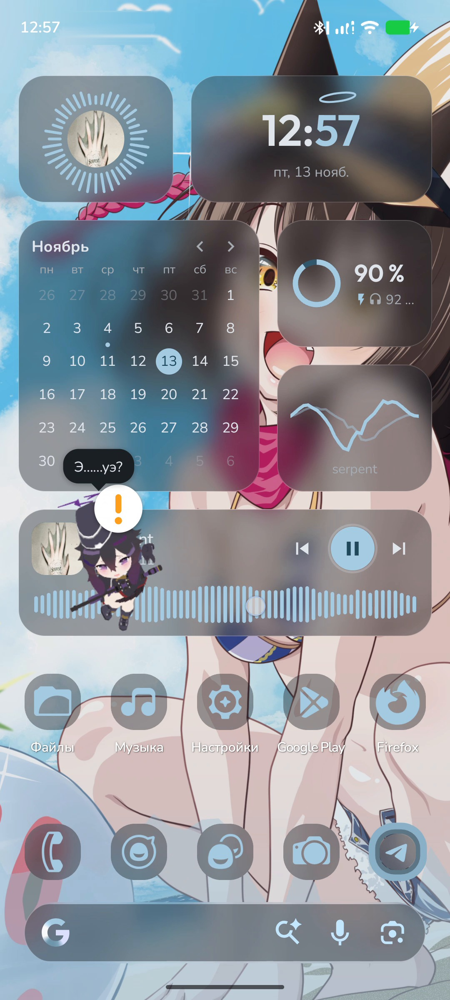
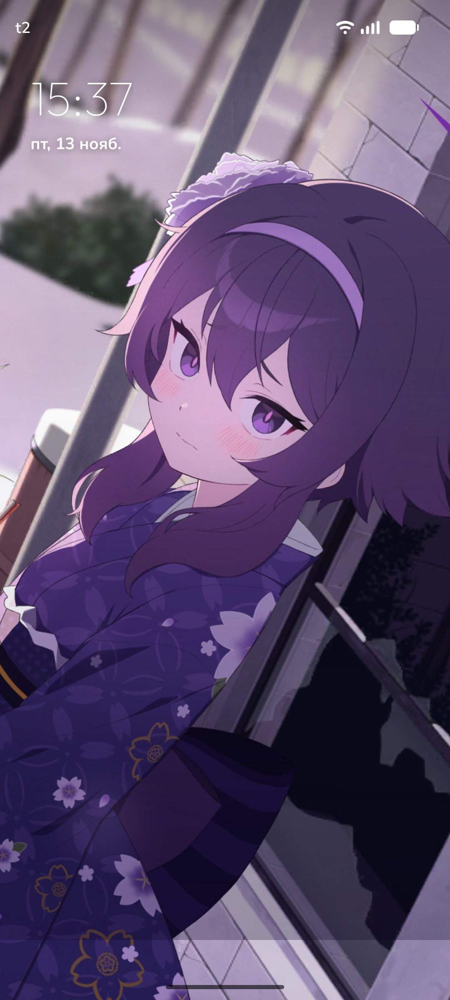

# BlueOS

**English** | [Русский](README.ru.md)

BlueOS is a fan-made Android ROM inspired by **Blue Archive**, based on **LineageOS 24.0 (Android 17)**.
It is developed on the **Google Pixel 6a**. The 0.9.0 builds include Google Play.

## Download BlueOS

| Device | Latest build | Instructions |
| --- | --- | --- |
| **Google Pixel 6a** (`bluejay`) | [0.9.0](https://github.com/GDmio/BlueOS/releases/tag/v0.9.0) · main release | [Install](https://github.com/GDmio/BlueOS/releases/download/v0.9.0/INSTALL.md) |
| **Samsung Galaxy S20 FE Snapdragon** (`r8q`) | [0.9.0](https://github.com/GDmio/BlueOS/releases/tag/v0.9.0-r8q) | [Install](https://github.com/GDmio/BlueOS/releases/download/v0.9.0-r8q/INSTALL-S20FE.md) |
| **POCO X3 Pro** (`vayu`, `bhima`) | [0.9.0](https://github.com/GDmio/BlueOS/releases/tag/v0.9.0-vayu) | [Install](https://github.com/GDmio/BlueOS/releases/download/v0.9.0-vayu/INSTALL-POCOX3Pro.md) |
| **TrebleDroid GSI** (`arm64_bvN4`) | [0.9.0](https://github.com/GDmio/BlueOS/releases/tag/v0.9.0-gsi-treble) · experimental | [DSU guide](https://github.com/GDmio/BlueOS/releases/download/v0.9.0-gsi-treble/GSI.md) |
| **Google Pixel 6** (`oriole`) | [0.9.0](https://github.com/GDmio/BlueOS/releases/tag/v0.9.0-oriole) · test build | [Install](INSTALL-Pixel6-0.9.md) |
| **Xiaomi Mi 9 Transparent Edition** (`cepheus`) | [0.9.0](https://github.com/GDmio/BlueOS/releases/tag/v0.9.0-cepheus) · test build | [Install](INSTALL-Mi9.md) |
| **OnePlus 9 Pro** (`lemonadep`) | [0.9.0](https://github.com/GDmio/BlueOS/releases/tag/v0.9.0-lemonadep) · test build | [Install](INSTALL-OnePlus9Pro.md) |
| **Google Pixel 6 Pro** (`raven`) | [0.8.1](https://github.com/GDmio/BlueOS/releases/tag/v0.8.1-raven) | [Install](INSTALL-Pixel6Pro.md) |

First boot on the Pixel 6, Mi 9 Transparent Edition and OnePlus 9 Pro is pending. Pixel 6 owners can also download the [device-tested 0.8.1 release](https://github.com/GDmio/BlueOS/releases/tag/v0.8.1-oriole).

The 0.9.0 GSI was tested through DSU on a Pixel 6a. Compatibility varies by device.
Follow the guide for your model and back up your data before installing. Unlocking the bootloader and formatting erase user data.

## What's new in 0.9.0

- **3D chibis on the home screen.** They react to touch, move around the screen and interact with widgets.
- **Interactive lobby.** Swipe right from the left edge of the lock screen. Testing covered 279 scenes.
- **Wallpaper jelly.** Selected areas of the wallpaper respond to phone motion and touch.
- **Calendar and wallpapers.** Added a month-view widget and wallpaper import on the phone.
- **Fixes and performance.** Widget blur survives a return from Recents. Live wallpapers and weather use fewer resources while swiping.

## Screenshots

<table>
<tr>
<td align="center" width="33%"> 3D chibi and widgets</td>
<td align="center" width="33%"> Lock-screen lobby</td>
<td align="center" width="33%"> Moe clock</td>
</tr>
</table>

Captured on a Pixel 6a. Characters, scenes and custom wallpapers were added separately.

## Character files

Blue Archive models, voices, music and other game files are excluded from the source and builds. Import your own files on the phone through **Wallpaper & style → Character → Add character files**. [Import guide](ASSETS.md)

Find updates and files for import in the [BlueOS Telegram channel](https://t.me/BlueOSfirmware).
BlueOS is an unofficial fan project and is unaffiliated with Nexon, Yostar or NEXON Games.

## Source and documentation

- [BlueOS 0.9.0 source](https://github.com/GDmio/BlueOS/tree/v0.9.0)
- [Build BlueOS](BUILDING.md) and [port it to another device](PORTING.md)
- [Guide for AI coding agents](AGENTS.md)
- [Acknowledgements](THANKS.md)

## What's inside
- `config/blueos.mk` — everything that hooks BlueOS into the build (one line in `vendor/extra/product.mk`).
- `patches/<project>/*.patch` — changes to LineageOS/AOSP code: SystemUI, the launcher, Wallpaper & style,
  Settings, Clock, Calendar, Gallery, recovery. They apply by themselves on `source build/envsetup.sh`.
- `libs/arona` — the shared library: BlueOS settings, colour roles, phone motion, weather, characters.
- `overlay/` — resources over the stock ones (names, default values).
- `fonts/`, `media/` (logo, boot animations), `sepolicy/`.
- `tools/` — the scripts that made the logo, the animations, the fonts and the Moe clocks.

## Licences
- **If you take something from BlueOS, credit the author.** BlueOS' own code and media are © 2026 GDmio: the
  patches, `libs`, `tools`, `config`, `overlay`, the logo, the boot animations and its own sounds. They are under the
  Apache License 2.0 with one added condition ([LICENSE](LICENSE)).
  - The condition applies when you distribute BlueOS or work based on it: a ROM, GSI, port or fork, or code, patches
    or media from here.
  - Keep the [NOTICE](NOTICE) file.
  - Say in your project's description, release notes or README that it is based on BlueOS by GDmio, with a link to
    https://github.com/GDmio/BlueOS .
  - Distribution without that is not licensed, and the author may ask for it to be taken down.
  - Installing and using BlueOS on your own phone needs nothing at all.
- The LineageOS/AOSP code that the patches change keeps its own licence (Apache License 2.0).
- The fonts in `fonts/` are under the SIL Open Font License (`OFL.txt` files next to them).
- The Moe clock digits come from [Moe-Counter](https://github.com/journey-ad/Moe-Counter), MIT
  (`media/moe/src/LICENSE-Moe-Counter`).
- `prebuilts/spine` — [Spine Runtimes](https://esotericsoftware.com/spine-runtimes-license) by Esoteric Software.
  Under their licence everyone who uses the Spine runtime needs their own Spine Editor licence. More in
  [NOTICE.md](NOTICE.md).
