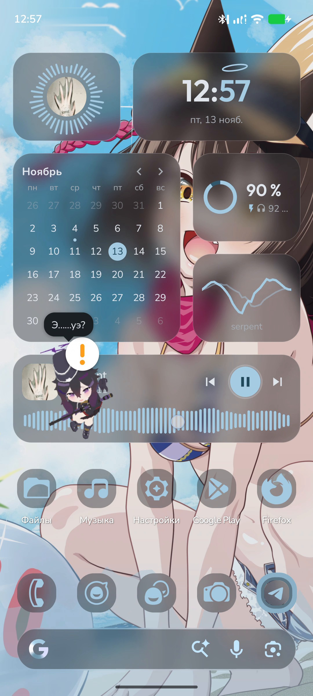
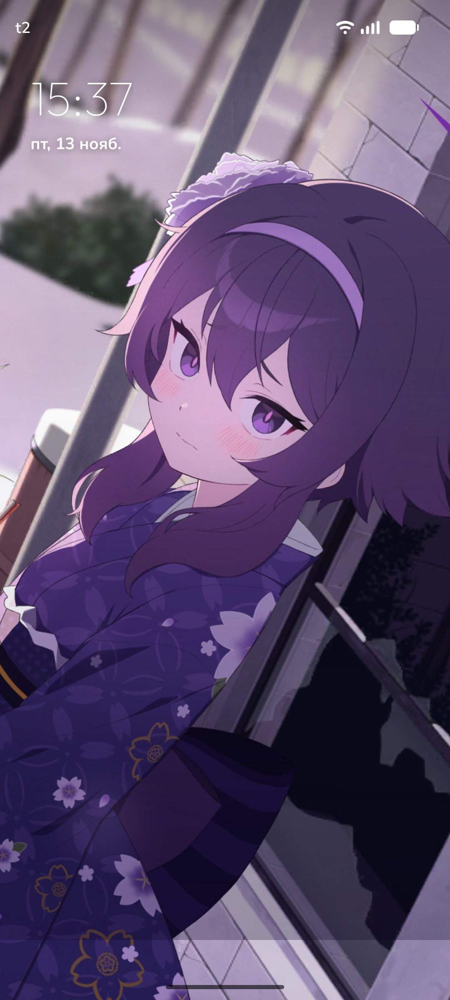

# BlueOS

[English](README.md) | **Русский**

BlueOS — фанатская прошивка в стиле **Blue Archive** на базе **LineageOS 24.0 (Android 17)**.
Разрабатывается на **Google Pixel 6a**. В сборках 0.9.0 есть Google Play.

## Скачать BlueOS

| Устройство | Последняя сборка | Инструкция |
| --- | --- | --- |
| **Google Pixel 6a** (`bluejay`) | [0.9.0](https://github.com/GDmio/BlueOS/releases/tag/v0.9.0) · основной релиз | [Установка](https://github.com/GDmio/BlueOS/releases/download/v0.9.0/INSTALL.ru.md) |
| **Samsung Galaxy S20 FE Snapdragon** (`r8q`) | [0.9.0](https://github.com/GDmio/BlueOS/releases/tag/v0.9.0-r8q) | [Установка](https://github.com/GDmio/BlueOS/releases/download/v0.9.0-r8q/INSTALL-S20FE.ru.md) |
| **POCO X3 Pro** (`vayu`, `bhima`) | [0.9.0](https://github.com/GDmio/BlueOS/releases/tag/v0.9.0-vayu) | [Установка](https://github.com/GDmio/BlueOS/releases/download/v0.9.0-vayu/INSTALL-POCOX3Pro.ru.md) |
| **TrebleDroid GSI** (`arm64_bvN4`) | [0.9.0](https://github.com/GDmio/BlueOS/releases/tag/v0.9.0-gsi-treble) · экспериментальная | [Инструкция по DSU](https://github.com/GDmio/BlueOS/releases/download/v0.9.0-gsi-treble/GSI.ru.md) |
| **Google Pixel 6** (`oriole`) | [0.9.0](https://github.com/GDmio/BlueOS/releases/tag/v0.9.0-oriole) · тестовая | [Установка](INSTALL-Pixel6-0.9.ru.md) |
| **Xiaomi Mi 9 Transparent Edition** (`cepheus`) | [0.9.0](https://github.com/GDmio/BlueOS/releases/tag/v0.9.0-cepheus) · тестовая | [Установка](INSTALL-Mi9.ru.md) |
| **OnePlus 9 Pro** (`lemonadep`) | [0.9.0](https://github.com/GDmio/BlueOS/releases/tag/v0.9.0-lemonadep) · тестовая | [Установка](INSTALL-OnePlus9Pro.ru.md) |
| **Google Pixel 6 Pro** (`raven`) | [0.8.1](https://github.com/GDmio/BlueOS/releases/tag/v0.8.1-raven) | [Установка](INSTALL-Pixel6Pro.ru.md) |

Загрузку 0.9.0 на Pixel 6, Mi 9 Transparent Edition и OnePlus 9 Pro ещё предстоит проверить. Для Pixel 6 доступна [проверенная на телефоне версия 0.8.1](https://github.com/GDmio/BlueOS/releases/tag/v0.8.1-oriole).

GSI 0.9.0 проверили через DSU на Pixel 6a. Совместимость с другими телефонами зависит от устройства.
Перед установкой выберите инструкцию для своей модели и сделайте резервную копию. При разблокировке загрузчика и форматировании данные стираются.

## Что нового в 0.9.0

- **3D-чиби на рабочем столе.** Реагируют на касания, двигаются по экрану и взаимодействуют с виджетами.
- **Интерактивное лобби.** На экране блокировки смахните вправо от левого края. При тестировании проверили 279 сцен.
- **Желе на обоях.** Выбранные участки обоев реагируют на движение телефона и касания.
- **Календарь и обои.** Добавили виджет месяца и импорт обоев с телефона.
- **Исправления и оптимизация.** Размытие виджетов сохраняется после возврата из «Недавних», живые обои и погода требуют меньше ресурсов при пролистывании.

## Как это выглядит

<table>
<tr>
<td align="center" width="33%"> 3D-чиби и виджеты</td>
<td align="center" width="33%"> Лобби на экране блокировки</td>
<td align="center" width="33%"> Часы Moe</td>
</tr>
</table>

Снимки с Pixel 6a. Персонажи, сцены и пользовательские обои добавлены отдельно.

## Файлы персонажа

Модели, голоса, музыка и другие файлы Blue Archive в сборки и исходники не входят. Свои файлы можно добавить прямо на телефоне через **«Обои и стиль» → «Персонаж» → «Добавить файлы персонажа»**. [Инструкция по импорту](ASSETS.ru.md)

Обновления и материалы для импорта опубликованы в [Telegram-канале BlueOS](https://t.me/BlueOSfirmware).
BlueOS — неофициальный фанатский проект, который не связан с Nexon, Yostar или NEXON Games.

## Исходники и документация

- [Исходники BlueOS 0.9.0](https://github.com/GDmio/BlueOS/tree/v0.9.0)
- [Сборка BlueOS](BUILDING.ru.md) и [портирование на другое устройство](PORTING.ru.md)
- [Руководство для ИИ-агента](AGENTS.md)
- [Благодарности](THANKS.ru.md)

## Что внутри
- `config/blueos.mk` — всё подключение BlueOS к сборке (одна строка в `vendor/extra/product.mk`).
- `patches/<проект>/*.patch` — изменения кода LineageOS/AOSP: SystemUI, лаунчер, «Обои и стиль», Настройки,
  Часы, Календарь, Галерея, recovery. Ставятся сами при `source build/envsetup.sh`.
- `libs/arona` — общая библиотека: настройки BlueOS, роли цветов, движение телефона, погода, персонажи.
- `overlay/` — ресурсы поверх стоковых (названия, значения по умолчанию).
- `fonts/`, `media/` (логотип, анимации загрузки), `sepolicy/`.
- `tools/` — скрипты, которыми сделаны логотип, анимации, шрифты и часы Moe.

## Лицензии
- **Если берёте что-то из BlueOS, укажите автора.** Код и материалы BlueOS — © 2026 GDmio: патчи, `libs`, `tools`,
  `config`, `overlay`, логотип, анимации загрузки и свои звуки. Они распространяются под Apache License 2.0 с одним
  дополнительным условием ([LICENSE](LICENSE)).
  - Условие действует, когда вы распространяете BlueOS или работу на его основе: прошивку, GSI, порт, форк, код,
    патчи или материалы отсюда.
  - Сохраните файл [NOTICE](NOTICE).
  - Напишите в описании, примечаниях к релизу или README своего проекта, что он основан на BlueOS от GDmio, со
    ссылкой на https://github.com/GDmio/BlueOS .
  - Без этого распространение не разрешено, и автор может потребовать его удалить.
  - Ставить BlueOS на свой телефон и пользоваться им можно без всяких условий.
- Код LineageOS/AOSP, который меняют патчи, остаётся под своей лицензией (Apache License 2.0).
- Шрифты в `fonts/` — SIL Open Font License (файлы `OFL.txt` рядом).
- Цифры часов Moe — проект [Moe-Counter](https://github.com/journey-ad/Moe-Counter), MIT
  (`media/moe/src/LICENSE-Moe-Counter`).
- `prebuilts/spine` — [Spine Runtimes](https://esotericsoftware.com/spine-runtimes-license) (Esoteric Software).
  По их лицензии каждому, кто использует рантайм Spine, нужна своя лицензия Spine Editor. Подробнее в
  [NOTICE.md](NOTICE.md).
